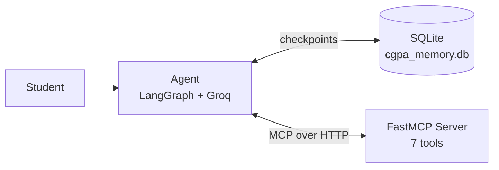

<div align="center">

# 🎓 GradePilot-MCP

### PUCIT BS(CS) Academic Advisor & CGPA Guider — Assignment 3

An AI academic advisor built on a **FastMCP** tool server, a **LangGraph** agent powered by **Groq**, and **SQLite** persistent memory.


**Roll Number:** `BCSF24M051` · **Repo:** [HafsaKokab/GradePilot-MCP](https://github.com/HafsaKokab/GradePilot-MCP) · **Live MCP:** [`compatible-olive-pheasant.fastmcp.app/mcp`](https://compatible-olive-pheasant.fastmcp.app/mcp)

</div>

---

## Table of Contents

1. [Project Overview](#1-project-overview)
2. [Technologies Used](#2-technologies-used)
3. [Installation and Setup](#3-installation-and-setup)
4. [Environment Variables](#4-environment-variables)
5. [FastMCP Server Setup](#5-fastmcp-server-setup)
6. [Agent Startup and Commands](#6-agent-startup-and-commands)
7. [The Seven MCP Tools](#7-the-seven-mcp-tools)
8. [Persistent Memory](#8-persistent-memory)
9. [Streaming](#9-streaming)
10. [Error Handling and Server Recovery](#10-error-handling-and-server-recovery)
11. [Prefect Horizon Live Deployment](#11-prefect-horizon-live-deployment)
12. [Submission Details](#12-submission-details)

---

## 1. Project Overview

GradePilot helps PUCIT BS(CS) students plan their academic performance through natural conversation. It can:

- Convert numeric marks to official PUCIT grade points
- Calculate credit-weighted semester GPAs
- Project a new CGPA from completed and current credit hours
- Compute the GPA required to reach a target CGPA
- Look up official semester course outlines and remaining credit hours
- Save calculation summaries to a report file on request



---

## 2. Technologies Used

| Component | Technology |
|---|---|
| Language | Python 3.12+ |
| MCP server & client | FastMCP 4.2.3 |
| Agent framework | LangChain / LangGraph (tools bound via `MCPAdapter`) |
| Persistent memory | `AsyncSqliteSaver` + SQLite |
| LLM | Groq — `openai/gpt-oss-20b` (or another Groq-hosted chat model) |
| Configuration | `python-dotenv` |
| Hosting | Prefect Horizon |

---

## 3. Installation and Setup

```bash
git clone https://github.com/HafsaKokab/GradePilot-MCP.git
cd GradePilot-MCP

python -m venv .venv

# Windows PowerShell
.\.venv\Scripts\Activate.ps1
# Linux / macOS
source .venv/bin/activate

pip install -r requirements.txt
pip install -r server/requirements.txt
```

---

## 4. Environment Variables

Copy `.env.example` to `.env` and fill in your own values:

```env
GROQ_API_KEY=your_groq_api_key_here
MCP_URL=http://127.0.0.1:8000/mcp
FASTMCP_KEY=your_optional_secret_token_here
```

| Variable | Description | Default |
|---|---|---|
| `GROQ_API_KEY` | Groq Cloud API key | *Required* |
| `MCP_URL` | FastMCP server endpoint | `http://127.0.0.1:8000/mcp` |
| `FASTMCP_KEY` | Optional bearer token for a hosted server | *Optional* |
| `PORT` | Port the local MCP server listens on | `8000` |

> ⚠️ Never commit `.env` or share real keys or tokens. Only `.env.example` (placeholders) belongs in the repository.

---

## 5. FastMCP Server Setup

Start the server from the project root:

```bash
python server/server.py
```

It listens on `http://0.0.0.0:8000/mcp` and exposes all seven tools. The server has no LLM or Groq dependency.

**Test the server independently of the agent** (PowerShell users: set `$env:PYTHONIOENCODING="utf-8"` first):

```bash
# List available tools
fastmcp list http://127.0.0.1:8000/mcp

# Call tools directly
fastmcp call http://127.0.0.1:8000/mcp marks_to_grade_points marks=85
fastmcp call http://127.0.0.1:8000/mcp get_semester_courses semester=5
fastmcp call http://127.0.0.1:8000/mcp calculate_semester_gpa --input-json '{"grade_points": [4.0, 3.7], "credit_hours": [3.0, 3.0]}'
```

> On Windows PowerShell, escape the inner quotes of `--input-json` as `\"`.

---

## 6. Agent Startup and Commands

In a second terminal with the virtual environment activated:

```bash
python agent.py
```

| Command | Action |
|---|---|
| `/new` | Start a new conversation thread with a fresh unique ID |
| `/history` | List all saved conversation threads |
| `/switch <THREAD_ID or NUMBER>` | Restore and switch to a saved conversation |
| `/forget <THREAD_ID or NUMBER>` | Permanently delete a saved conversation |
| `quit` / `exit` | End the session |

---

## 7. The Seven MCP Tools

| # | Tool | Description |
|---|---|---|
| 1 | `marks_to_grade_points(marks: int) -> float` | Converts marks (0–100) to PUCIT grade points; validates the input range |
| 2 | `calculate_semester_gpa(grade_points: list[float], credit_hours: list[float]) -> float` | Credit-weighted GPA for one semester |
| 3 | `calculate_new_cgpa(current_cgpa, completed_credit_hours, semester_gpa, semester_credit_hours) -> float` | Projects the new CGPA after a semester |
| 4 | `required_gpa_for_target(target_cgpa, current_cgpa, completed_credit_hours, remaining_credit_hours) -> float` | GPA required over the remaining credit hours to reach a target CGPA; used horizon by horizon |
| 5 | `get_semester_courses(semester: int) -> str` | Official course codes, names, and credit hours for semesters 1–8 |
| 6 | `get_remaining_credit_hours(current_semester: int) -> float` | Graded credit hours left from `current_semester + 1` to 8 (134.0 total degree credits) |
| 7 | `save_report(filename: str, content: str) -> str` | Saves a summary to a text file, only after explicit student confirmation |

**Grade bands used by `marks_to_grade_points`**

| Marks | 85+ | 80–84 | 75–79 | 70–74 | 65–69 | 61–64 | 58–60 | 55–57 | 50–54 | <50 |
|---|:-:|:-:|:-:|:-:|:-:|:-:|:-:|:-:|:-:|:-:|
| **Grade points** | 4.0 | 3.7 | 3.3 | 3.0 | 2.7 | 2.3 | 2.0 | 1.7 | 1.0 | 0.0 |

**Semester GPA** = Σ(grade point × credit hours) ÷ Σ(credit hours)

---

## 8. Persistent Memory

Conversation state is stored with **`AsyncSqliteSaver`** in `cgpa_memory.db`.

- Each conversation is an isolated thread with a unique ID
- Saved threads are listed when `agent.py` starts
- Restarting the agent restores earlier conversations with their full message history
- `/switch` and `/forget` validate their input

---

## 9. Streaming

Responses are streamed with `agent.astream()` using:

```python
stream_mode=["updates", "messages"]
version="v2"
```

Tokens are printed progressively with `flush=True`, and both message chunks and graph updates are handled without duplicate output.

---

## 10. Error Handling and Server Recovery

- **Server disconnection:** if the FastMCP server drops, the agent logs it and retries automatically at a fixed interval (`RECONNECT_DELAY`, 5 seconds).
- **Incomplete tool calls:** `recover_conversation()` detects `AIMessage`s that have no matching `ToolMessage` and removes only those incomplete calls from the saved state using `RemoveMessage`. Valid history is kept, which avoids Groq `400 Bad Request` errors on the next turn.
- **Clean exit:** `KeyboardInterrupt` and `EOFError` are caught so the agent shuts down without a traceback.

---

## 11. Prefect Horizon Live Deployment

| | |
|---|---|
| **Live MCP URL** | `https://compatible-olive-pheasant.fastmcp.app/mcp` |
| **Platform** | Prefect Horizon |
| **Transport** | Streamable HTTP (`/mcp`) |
| **Authentication** | OAuth 2.1 |

### Run the agent against the live server

1. Set the URL in `.env`:
   ```env
   GROQ_API_KEY=your_groq_api_key_here
   MCP_URL=https://compatible-olive-pheasant.fastmcp.app/mcp
   ```
2. Start the agent:
   ```bash
   python agent.py
   ```
3. **First run:** the agent starts the OAuth flow and opens a browser page for a one-click authorization.
4. **Later runs:** tokens are cached and refreshed from the local `.fastmcp_auth/` folder, so you are not asked to log in again. Keep this folder out of version control.

### Run locally instead

```bash
python server/server.py          # terminal 1
# set MCP_URL=http://127.0.0.1:8000/mcp in .env
python agent.py                  # terminal 2
```

---

## 12. Submission Details

| | |
|---|---|
| **Student Roll Number** | `BCSF24M051` |
| **GitHub Repository** | [github.com/HafsaKokab/GradePilot-MCP](https://github.com/HafsaKokab/GradePilot-MCP) |
| **Live MCP Server** | [compatible-olive-pheasant.fastmcp.app/mcp](https://compatible-olive-pheasant.fastmcp.app/mcp) |
| **Deployment Platform** | Prefect Horizon |
